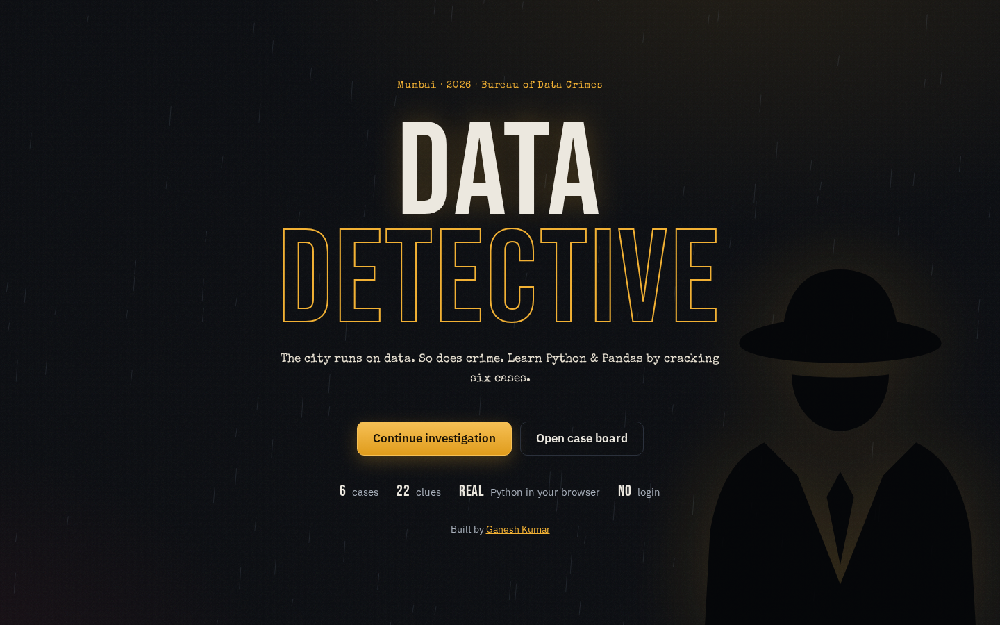
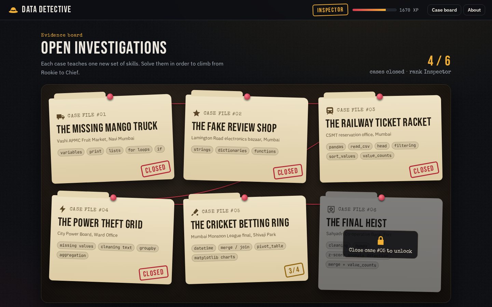
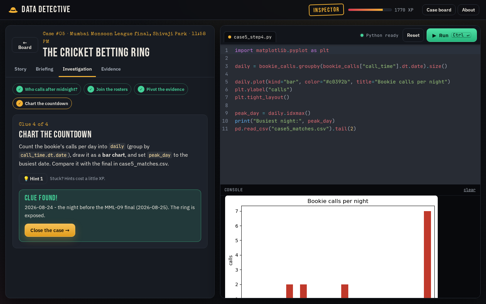
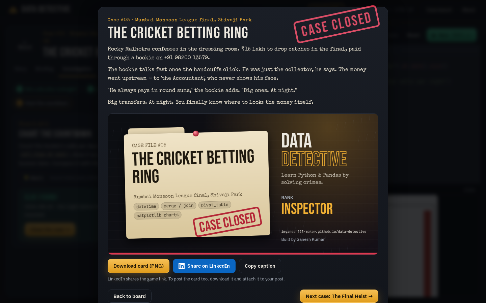
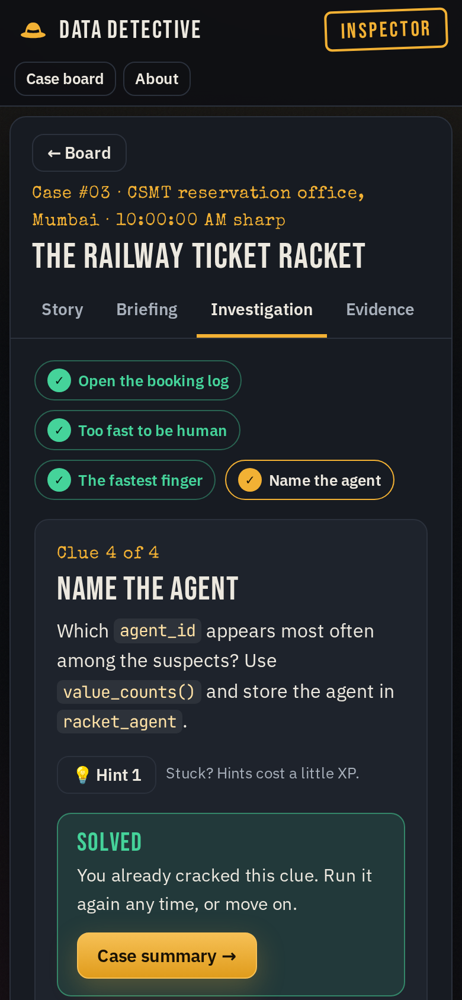

# 🕵️ Data Detective

**Learn Python & Pandas by solving crimes.** Data Detective is a noir detective story that runs in your browser. You're a rookie at Mumbai's Bureau of Data Crimes, every clue is hidden in a dataset, and the only way to crack a case is to write **real Python**. Your code runs right on the page (Pyodide), gets checked automatically, and you work your way up from `print()` to anomaly detection.

### ▶ Play it: **https://imganesh523-maker.github.io/data-detective/**

No login, no install, no backend, no tracking. Your progress stays in your own browser.



| Evidence board | Investigating (real matplotlib chart, made in the browser) |
|---|---|
|  |  |

| Case closed + share card | Mobile |
|---|---|
|  |  |

---

## How it plays

Each case is a chapter:

1. **Story:** a typewriter intro and a dossier on the person who brings you the case.
2. **Briefing:** a short lesson card on the new idea, with a tiny example you can run.
3. **Investigation:** 2–4 clues. Write code in the editor, press **Run** (or `Ctrl+Enter`), and the game checks your variables and output.
   - A wrong answer gets *specific* feedback ("Close! But some of those are General quota…"), not just "wrong".
   - Python errors are explained in plain English (`NameError` → "Python doesn't know anything called `totl`. Check the spelling…").
   - Hints come in 3 levels. The last one shows the solution. Hints cost a little XP.
4. **Case Closed:** a stamp, the ending of the story, a rank check, and a **1200×627 share card** you can download, plus a "Share on LinkedIn" button.

Your rank goes **Rookie → Sub-Inspector → Inspector → Chief** as you close cases. And yes, the six cases are connected: someone is paying for every crime in the city.

## Curriculum

| # | Case | What you learn | Evidence |
|---|------|----------------|----------|
| 1 | **The Missing Mango Truck**: an Alphonso truck vanishes on the way to Vashi APMC | variables, `print`, lists, `for` loops, `if` / `not in` | `case1_gate_log.csv` |
| 2 | **The Fake Review Shop**: a 4.9-star electronics shop on Lamington Road | strings (`.lower()`, `in`), dictionaries & counting, functions | `case2_reviews.csv` |
| 3 | **The Railway Ticket Racket**: Tatkal seats gone in 2 seconds | pandas: `read_csv`, `head`, `len`, boolean filtering with `&`, `sort_values`, `value_counts` | `case3_tickets.csv` |
| 4 | **The Power Theft Grid**: power goes in but never gets billed | missing values (`isna`, `dropna`), text cleaning (`.str.strip().str.title()`), `groupby` + aggregation, Series maths | `case4_meter_readings.csv`, `case4_feeder_supply.csv` |
| 5 | **The Cricket Betting Ring**: a local T20 final that was sold | `pd.to_datetime` & `.dt`, `merge` (joins), `pivot_table`, matplotlib bar chart | `case5_calls.csv`, `case5_players.csv`, `case5_matches.csv` |
| 6 | **The Final Heist**: following the money | cleaning `₹3,943.09` text into numbers, **NumPy z-score anomaly detection**, merge + `value_counts` to name the mastermind | `case6_transactions.csv`, `case6_accounts.csv` |

That's 22 clues in all. Every dataset is small, realistic and **completely fictional**. They're made by [`tools/generate_data.py`](tools/generate_data.py) with fixed random seeds.

## Tech

- **Python in the browser:** [Pyodide 0.28](https://pyodide.org) (CPython → WebAssembly) running in a **Web Worker**, so the page never freezes. pandas, NumPy and matplotlib load lazily, only when a case needs them. An infinite loop is stopped after 20 s and the lab restarts on its own.
- **One runtime, two places:** [`js/runtime.py`](js/runtime.py) runs the player's code (it replays earlier steps, captures output, shows the last expression like a notebook with DataFrames as HTML tables, turns errors into plain English, and grabs charts as PNG). The **same file** is used by the offline test suite.
- **Editor:** CodeMirror 6 (Python mode, One Dark), bundled into [`vendor/`](vendor/) with esbuild, so there's no CDN dependency for the editor. If it can't load, the game falls back to a plain textarea.
- **Frontend:** plain HTML/CSS/JavaScript modules, no framework. Typewriter text, evidence-board layout with red string, CSS animations, rain on a canvas (turned off for `prefers-reduced-motion`), keyboard-accessible tabs, high-contrast colours, responsive down to 360 px.
- **Share cards:** drawn on a `<canvas>` at 1200×627 and saved as a PNG. The Open Graph image ([`assets/og-image.png`](assets/og-image.png)) is drawn by the same code, so it looks the same as the cards players share.
- **Content as data:** [`tools/build_cases.py`](tools/build_cases.py) builds `data/cases.json` (story, lessons, steps, hints, checkers). Expected answers are **computed from the CSVs**, so the story and the checkers always match.

```
index.html            page shell + Open Graph tags
css/style.css         noir theme
js/app.js             game engine: views, state, editor, console, share cards
js/worker.js          Pyodide web worker
js/runtime.py         code runner + friendly errors + checker harness (shared with tests)
data/                 cases.json + evidence CSVs
vendor/               CodeMirror 6 bundle (MIT)
assets/               self-hosted fonts, favicon, og-image.png
tools/                data generator, case builder, Python test suite, browser test, og-image maker
```

## Testing

Two layers, both run before every release:

```bash
pip install pandas numpy matplotlib playwright && python -m playwright install chromium
python tools/generate_data.py && python tools/build_cases.py

# 1) Real Python: every reference solution passes, every starter + hand-written wrong answer fails,
#    every briefing example runs, and the error explanations hold up (97 checks)
python tools/verify_cases.py

# 2) Real browser: headless Chromium + real Pyodide from the CDN plays all 6 cases like a player
python -m http.server 8765 &
python tools/e2e_test.py mango reviews railway
python tools/e2e_test.py power cricket heist --misc   # + infinite-loop recovery, wrong logic, reload
```

The browser test types each solution into the editor, presses Run, waits for "Clue found!", and checks that the Case Closed overlay and a 1200×627 share card show up. It also checks that the chart renders, that wrong logic is rejected with a specific tip, that an infinite loop gets stopped, and that progress is still there after a reload.

## Run it locally

Any static server works (the Python lab needs `http://`, not `file://`):

```bash
git clone https://github.com/imganesh523-maker/data-detective.git
cd data-detective && python -m http.server 8000
# open http://localhost:8000
```

## Known limitations

- **First load downloads Python:** roughly 10 MB for the Pyodide core, about 10 MB more for pandas + NumPy (cases 3–6), and about 10 MB more for matplotlib (case 5). Each piece downloads only when a case needs it and is cached by the browser after that. You need to be online the first time. On a slow mobile connection, the first pandas case can take 20–60 s to get ready.
- Code runs in your browser's memory. Very large loops are slower than desktop Python, and anything that runs longer than 20 s is stopped.
- The NumPy z-score is used for anomaly detection instead of scikit-learn, to keep downloads small.
- LinkedIn's share link only shares the URL (it shows the preview image). To post your personal case card, download it and attach it to your post.

## Credits & licence

- [Pyodide](https://pyodide.org) (MPL-2.0); pandas, NumPy, matplotlib (BSD / PSF-based licences), served from jsDelivr
- [CodeMirror 6](https://codemirror.net) (MIT)
- Fonts: Bebas Neue, IBM Plex Sans, JetBrains Mono (SIL OFL 1.1), Special Elite (Apache 2.0), self-hosted
- Illustrations, icons, story and datasets: original work for this project. Any resemblance to real people, phone numbers or accounts is a coincidence.

Code released under the [MIT License](LICENSE).

---

**Built by Ganesh Kumar** · [GitHub](https://github.com/imganesh523-maker) · [LinkedIn](https://www.linkedin.com/in/ganeshkumar-ai/)
